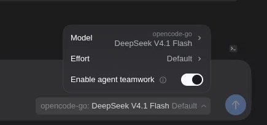

# Model provider info (`@wasp/dsh-model-provider-info`)

Tells you *which provider* serves the model you picked. The composer's model
selector shows a model name such as `deepseek-v4.1-flash-1017`, which the same
name can carry in several providers; this plugin puts the provider next to it.



## What it gives you

| Surface | Behaviour |
|---|---|
| **Composer chip** | The selected model reads `provider: model`, e.g. `opencode-go: deepseek-v4.1-flash-1017`. The provider is drawn in the selector's dimmer caption tone, the model name stays primary. |
| **Dropdown → Model row** | Opening the selector shows the provider on its own line directly above the model name, right-aligned in the row's value cell. |
| **Model list** | Rows keep the plain model name: the drilled list already groups models under a provider heading. |
| **Provider text** | The catalog's provider display name when one is configured (`DeepSeek account`, `Local`), otherwise the provider id (`opencode-go`, `alibaba`). |

Only the labels change. Selection, model search, the reasoning-effort menu, and
the `/model` slash-command picker keep their shipped behaviour.

## Requirements

- DeepSeek Harness with the Web UI (Desktop, or a `web` profile). The plugin
  contributes a label to the shipped composer model selector
  (`@deepseek-ai/dsh-client-ui-model-selection`), which `@deepseek-ai/dsh-web-app`
  already mounts.
- A session whose model selector is available; addressed subagent sessions hide
  that selector, so nothing is shown there.

No configuration, credentials, network access, or Host code. The Host half is a
no-op.

## Install

**Web (recommended).** Open the **Plugins** page in the sidebar, click **Add
plugin**, and paste this repository:

```
github:kkazakov/dsh-model-provider-info-plugin
```

Or, once published to npm, the package name:

```
@wasp/dsh-model-provider-info
```

**From a local checkout**, point **Add plugin** (or the `plugin_manager` tool
with `action: install_bundle`) at the directory that contains `package.json`.

**Agent / tool surface:** `plugin_manager` with `action: install_bundle` and the
same spec.

**CLI:** `dsh plugin add github:kkazakov/dsh-model-provider-info-plugin` runs
pnpm in the profile directory. It does not select the bundle for you — use the
Web **Plugins** page to get bundle selection and patch application.

Installing runs the plugin **in-process with your permissions**. Only install it
from a source you trust.

After installing, open the composer's model selector. No restart is needed: the
bundle applies immediately through HMR, and a page refresh picks up the label if
the tab was already open.

### Upgrading

DeepSeek Harness does not auto-update plugins yet: **uninstall and reinstall**
to move to a new version. Pin a version with e.g.
`@wasp/dsh-model-provider-info@1.0.0` if you need reproducibility.

### Uninstall

Remove **Model provider info** in **Plugins**, or
`plugin_manager` `action: remove_bundle` with `@wasp/dsh-model-provider-info`.
The stock labels return immediately.

## Limitations

- The chip's tooltip and accessible name are owned by the shipped selector and
  still name only the model and reasoning effort; the provider is visible in the
  chip text and in the dropdown.
- The longer chip label raises the composer row's demand for text, so on a very
  narrow composer row the selector may collapse to its model icon sooner than
  before.
- Provider-authored model badges beside the name are not reproduced by this
  label (the label slot does not expose badge text resolution).
- A genuinely separate row above the **Model** row would require replacing the
  entire shipped selector; this plugin deliberately uses the sanctioned label
  slot and stacks the provider inside that row instead.

## How it works

- `client.js` is the whole feature. It registers one occupant of the inline
  single slot `conversation.input.model.label`, which the shipped model selector
  renders in three placements — `trigger` (the chip), `menu` (the root menu's
  Model row value) and `option` (a selectable model row) — and branches on
  `placement` to render the provider above, beside, or omitted from the name.
  The contribution comes from catalog data (`provider.name`/`provider.id`,
  `model.name`) only.
- The registration is installed through `ctx.slots.inject`, so it exists exactly
  while the selector's declaration is live and is removed when the selector or
  this plugin unloads.
- `cordis.patch.yml` inserts the Host row; `index.js` exports an empty `apply`,
  so the bundle holds no Host state. `dsh.client.inject` only orders activation
  after the model-selection plugin.
- Styling uses host theme tokens (`--dsw-alias-label-caption`,
  `--dsw-alias-label-tertiary`), so the label follows light/dark themes and
  theme changes. No Harness Client package is imported, so a DSH release cannot
  break this bundle by moving a primitive.
- The browser half contains no side effects at load: `factory(require)` runs at
  materialization and the returned plugin registers the slot in `apply`.

## Development

```
node --check client.js      # syntax
npm test                    # manifest, loader shape, and label rendering checks
```

`test-plugin.mjs` loads the browser half the way the Harness module loader does
(`window.__ModuleLoader__.load`) against stub React and a stub Cordis context,
then asserts the slot registration, the three placements' output, the display
name/id fallback, and the package manifest against the files on disk. It needs
neither a Harness installation nor a browser.

## License

MIT — see [LICENSE](LICENSE).
